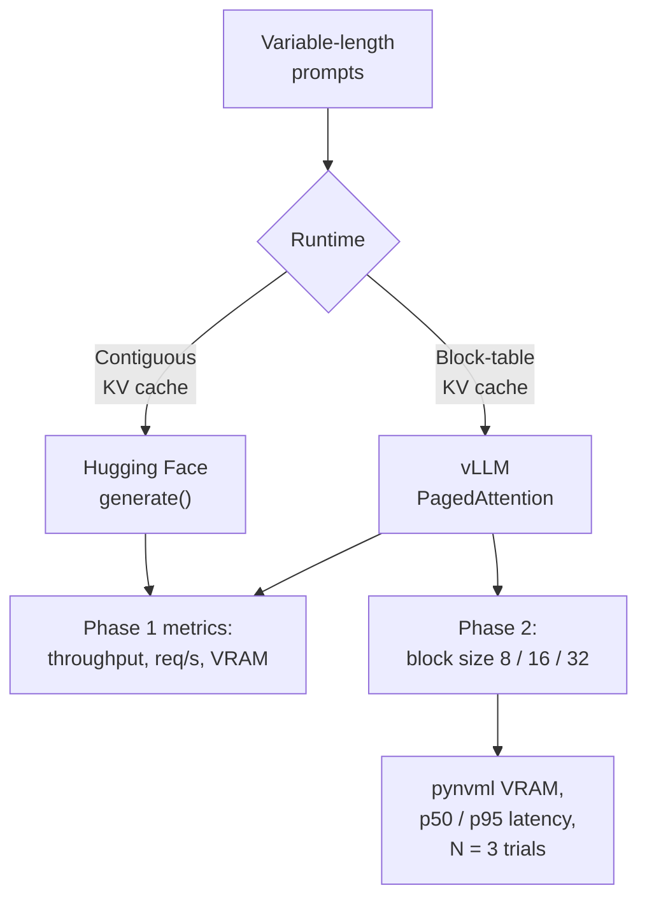
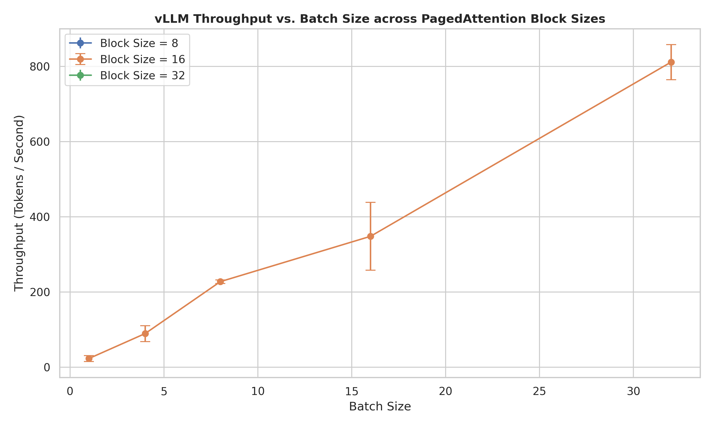
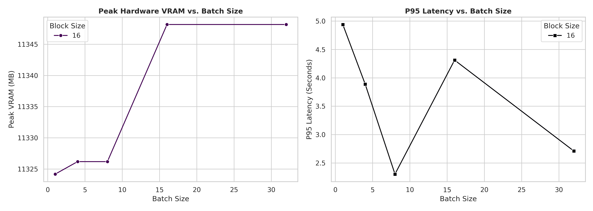

<div align="center">

# ⚡ vLLM PagedAttention Benchmark

### Empirical inference benchmarking, KV-cache analysis & block-size ablation on an NVIDIA Tesla T4

[](https://www.python.org/)
[](https://pytorch.org/)
[](https://github.com/vllm-project/vllm)
[](https://www.nvidia.com/)
[](LICENSE)

[](https://colab.research.google.com/github/adriennie/vllm-pagedattention-benchmark/blob/main/vllm_pagedattention_block_size_ablation.ipynb)
[](https://nbviewer.org/github/adriennie/vllm-pagedattention-benchmark/blob/main/vllm_pagedattention_block_size_ablation.ipynb)

[**Highlights**](#-highlights) · [**Phase 1**](#-phase-1--vllm-vs-hugging-face) · [**Phase 2**](#-phase-2--block-size-ablation--hardware-profiling) · [**Reproduce**](#-reproducing-the-experiments) · [**Roadmap**](#-roadmap)

</div>

---

## 🚀 Highlights

| | |
| :-- | :-- |
| 🏆 **Peak speedup** | **5.06× throughput** (877.69 vs 173.45 tok/s) for vLLM over the Hugging Face baseline at batch size 32 |
| 🧠 **Core idea** | PagedAttention replaces contiguous per-sequence KV-cache allocation with block-level virtual-memory-style mapping |
| 🔬 **Phase 1** | vLLM vs Hugging Face `generate()` across batch sizes 1 → 32 with variable-length prompts |
| 🧪 **Phase 2** | Block-size ablation (8 / 16 / 32), `pynvml` background VRAM telemetry, N = 3 repeatability trials, p50 / p95 latency |
| 🧾 **Provenance** | Run environment captured in `run_metadata.csv`; raw results version-controlled as CSV |
| 🖥️ **Hardware** | NVIDIA Tesla T4 on Google Colab and Kaggle |

> **Honest scoping.** This is a small, reproducible notebook study of the memory-management ideas behind vLLM, not a reproduction of the full system or evaluation in the original paper. Phase 1 documents its own instrumentation gaps openly; Phase 2 was built to close them.

---

## 📖 Background

Autoregressive generation repeatedly attends to every token produced so far. The **key–value (KV) cache** stores those attention keys and values so they are not recomputed at every decode step. Because requests arrive and finish at different times, cache demand changes dynamically, and in some serving setups the KV cache takes up a substantial fraction of usable GPU memory, which directly limits concurrency.

**Contiguous allocation** reserves a large tensor region per sequence, usually sized for a maximum length. Short requests leave reserved capacity unused, and variable lengths cause fragmentation.

**PagedAttention** (vLLM) splits the KV cache into fixed-size logical blocks and maps them to non-contiguous physical GPU blocks as generation proceeds, borrowing indirection and allocation ideas from OS virtual memory. The result is less wasted cache and room for higher concurrency.

This project is grounded in Kwon et al., [*Efficient Memory Management for Large Language Model Serving with PagedAttention*](https://arxiv.org/abs/2309.06180) (SOSP 2023).



---

## 🧱 Architecture

| Concern | Hugging Face baseline | vLLM path |
| :-- | :-- | :-- |
| Generation API | PyTorch model + Transformers `generate()` | vLLM `LLM.generate()` |
| KV-cache handling | Model/runtime-managed cache allocation | PagedAttention block-managed KV cache |
| Scheduling | Batched generation calls | vLLM engine scheduling and batching |
| Phase 1 model | `Qwen/Qwen2.5-1.5B-Instruct` | `Qwen/Qwen2.5-1.5B-Instruct` |

**vLLM configuration (Phase 1):** Engine V0 (`VLLM_USE_V1=0`), 16-token cache block, eager execution, FP16, 2,048-token context limit, 0.80 GPU memory utilization.

**Stack:** Python · PyTorch · vLLM · Hugging Face Transformers · `pynvml` · Pandas · Seaborn · Matplotlib

**Recorded environment:** Python 3.13.15, PyTorch 2.11.0+cu128, CUDA 12.8, NVIDIA Tesla T4. These are recorded details, not pinned install requirements.

---

## 🔬 Phase 1 — vLLM vs Hugging Face

### Workload

- **Batch sizes:** 1, 2, 4, 8, 16, 32 concurrent requests
- **Prompts:** repeating mix of short, medium and long prompts
- **Decoding:** up to 128 new tokens per request, greedy (`temperature=0` for vLLM, `do_sample=False` for Transformers)
- **Metrics:** aggregate generated-token throughput (tok/s), request rate (req/s), aggregate seconds per generated token per request, PyTorch allocated VRAM where captured

> Throughput and request rate are aggregate batch measurements. "Agg sec/tok/req" is elapsed batch time divided by generated tokens per request. It is **not** a per-token latency distribution and does not include TTFT, TPOT or P95/P99.

### Results

Source: [`final_vllm_vs_hf_benchmark.csv`](final_vllm_vs_hf_benchmark.csv)

| Batch | HF tok/s | vLLM tok/s | **Speedup** | HF req/s | vLLM req/s | HF agg s/tok/req | vLLM agg s/tok/req | HF peak alloc. VRAM (GB) |
| --: | --: | --: | :-: | --: | --: | --: | --: | --: |
| 1 | 18.77 | 30.05 | **1.60×** | 0.15 | 0.23 | 0.0533 | 0.0333 | 3.47 |
| 2 | 18.19 | 50.13 | **2.76×** | 0.14 | 0.39 | 0.1099 | 0.0399 | 3.48 |
| 4 | 36.04 | 116.06 | **3.22×** | 0.28 | 0.91 | 0.1110 | 0.0345 | 3.49 |
| 8 | 61.42 | 226.98 | **3.70×** | 0.48 | 1.77 | 0.1303 | 0.0352 | 3.55 |
| 16 | 107.00 | 270.61 | **2.53×** | 0.84 | 2.11 | 0.1495 | 0.0591 | 3.63 |
| 32 | 173.45 | 877.69 | **5.06×** | 1.36 | 6.86 | 0.1845 | 0.0365 | 3.80 |

The combined CSV also contains a second Hugging Face row, `Hugging Face generate()`, from a separate benchmark path. At batch 32 it records 613.65 tok/s, which puts vLLM at **1.43×** that row. The two HF entries are kept because they come from different runs and should not be treated as replicates. Which baseline is appropriate depends on the question being asked.

<div align="center">


*Throughput scaling (left) and peak allocated VRAM (right). The vLLM VRAM series is uncaptured data; see the limitation below.*

</div>

### Interpretation and known limits

- **Scaling:** throughput rises with batch size for both runtimes, and vLLM leads at every batch size measured. Block allocation avoids reserving a contiguous maximum-length cache per request, and block tables map logical positions to physical KV blocks, which plausibly explains the scaling. This benchmark does **not** isolate PagedAttention from scheduling, kernel and batching differences.
- **VRAM:** the vLLM VRAM values in the CSV are `0.0`. That means *not captured*, not zero usage, because PyTorch allocator counters miss memory managed by vLLM and CUDA. The HF figures are PyTorch allocated memory, not total device usage. The VRAM panel is therefore not a valid memory comparison, which is exactly what Phase 2 addresses.
- **Controls:** runs were done in notebook environments without strict apples-to-apples controls. Treat the numbers as observations for this workload and environment, not universal performance guarantees.

---

## 🧪 Phase 2 — Block-Size Ablation & Hardware Profiling

Phase 1 left open questions about memory measurement and run-to-run noise. Phase 2 turns the notebook study into a more rigorous benchmarking harness.

| Upgrade | What it adds |
| :-- | :-- |
| 📌 **Version pinning & provenance** | Software and hardware runtime details recorded to [`run_metadata.csv`](run_metadata.csv) |
| 📡 **Background VRAM telemetry** | Asynchronous `pynvml` sampling thread captures true device-level peak VRAM instead of relying on PyTorch allocators |
| 🧩 **Block-size ablation** | PagedAttention block sizes **8, 16, 32** evaluated across batch sizes up to **32** |
| 🔁 **Repeatability trials** | **N = 3** trials per configuration, reporting mean throughput with standard-deviation error bars |
| ⏱️ **Latency distribution** | **p50 / p95** latency alongside throughput |

### Results

Full trial logs: [`vllm_block_size_ablation.csv`](vllm_block_size_ablation.csv) · Environment: [`run_metadata.csv`](run_metadata.csv)

<!-- TODO: replace the placeholder cells with values from vllm_block_size_ablation.csv.
     Add rows for block sizes 8 and 32 as well if you want the full ablation visible here. -->

| Block size | Batch | Throughput mean (tok/s) | Throughput std | P50 latency (s) | P95 latency (s) | Peak VRAM (MB) |
| :-: | --: | --: | --: | --: | --: | --: |
| 16 | 1 | — | — | — | — | — |
| 16 | 4 | — | — | — | — | — |
| 16 | 8 | — | — | — | — | — |
| 16 | 16 | — | — | — | — | — |
| 16 | 32 | — | — | — | — | — |

<div align="center">



*Throughput (tokens/s) vs batch size across block sizes, with standard-deviation bounds over N = 3 trials.*



*`pynvml` peak VRAM and P95 latency across scaling workloads.*

</div>

---

## 📂 Repository Structure

```text
.
├── vllm_vs_hf_benchmark.ipynb                     # Phase 1: Colab vLLM run + comparison workflow
├── vllmproject.ipynb                              # Phase 1: Kaggle exploration + Hugging Face baseline
├── vllm_pagedattention_block_size_ablation.ipynb  # Phase 2: ablation + pynvml profiling (Colab)
├── final_vllm_vs_hf_benchmark.csv                 # Phase 1: combined HF + vLLM measurements
├── vllm_results.csv                               # Phase 1: vLLM measurements
├── vllm_vs_hf_final_comparison.png                # Phase 1: throughput + VRAM plot
├── vllm_block_size_ablation.csv                   # Phase 2: mean, std, latency, VRAM per config
├── vllm_block_size_ablation.png                   # Phase 2: throughput error-bar plot
├── vllm_vram_latency_profile.png                  # Phase 2: peak VRAM + P95 latency profile
├── run_metadata.csv                               # Phase 2: pinned runtime versions
├── results/
│   ├── benchmark_results.csv                      # Phase 1: Hugging Face measurements
│   ├── run_metadata.csv                           # Phase 1: Python / PyTorch / CUDA / GPU metadata
│   ├── vllm_vs_hf_benchmark.png                   # Phase 1: Kaggle notebook plot
│   └── __results___files/                         # Notebook-exported image artifacts
├── LICENSE
└── README.md
```

---

## ▶️ Reproducing the Experiments

**Phase 1: vLLM vs Hugging Face**

1. Open `vllm_vs_hf_benchmark.ipynb` in Colab on a Tesla T4-class GPU. The Hugging Face baseline lives in `vllmproject.ipynb` (developed for Kaggle).
2. Check the configuration before running: Qwen2.5-1.5B-Instruct, batch sizes `[1, 2, 4, 8, 16, 32]`, variable prompts, up to 128 new tokens, vLLM Engine V0.
3. Run the baseline and vLLM cells and save `benchmark_results.csv` and `vllm_results.csv`.
4. Place both CSVs in the working directory and run the comparison cell. It writes `final_vllm_vs_hf_benchmark.csv` and `vllm_vs_hf_final_comparison.png`.

**Phase 2: block-size ablation**

1. Click the **Open in Colab** badge at the top and select an **NVIDIA Tesla T4** (or better) runtime.
2. Run the cells in order: dependency install → `pynvml` telemetry thread → ablation grid → CSV/PNG export.
3. Download `run_metadata.csv`, `vllm_block_size_ablation.csv`, `vllm_block_size_ablation.png` and `vllm_vram_latency_profile.png`, then commit them.

> Model access may require a Hugging Face account and token. Supply credentials through the notebook's secret manager or environment variables, and never commit tokens to the repo.

---

## 🗺️ Roadmap

- [x] Phase 1: vLLM vs Hugging Face throughput comparison across batch sizes
- [x] Phase 2: block-size ablation with repeatability trials and latency percentiles
- [x] Phase 2: device-level VRAM profiling with `pynvml`
- [ ] Add TTFT / TPOT and P99 latency
- [ ] Re-run the Phase 1 comparison with the Phase 2 harness (shared harness, pinned versions, `pynvml` VRAM for both runtimes)
- [ ] Benchmark vLLM **Engine V1** on Ampere / L4 GPUs
- [ ] Simulate production traffic with asynchronous Poisson request arrivals via async clients

---

## 📚 Reference

> Kwon, W. et al. "Efficient Memory Management for Large Language Model Serving with PagedAttention." *Proceedings of the 29th Symposium on Operating Systems Principles (SOSP 2023).* [arXiv:2309.06180](https://arxiv.org/abs/2309.06180)

## 📄 License

Released under the [MIT License](LICENSE).
