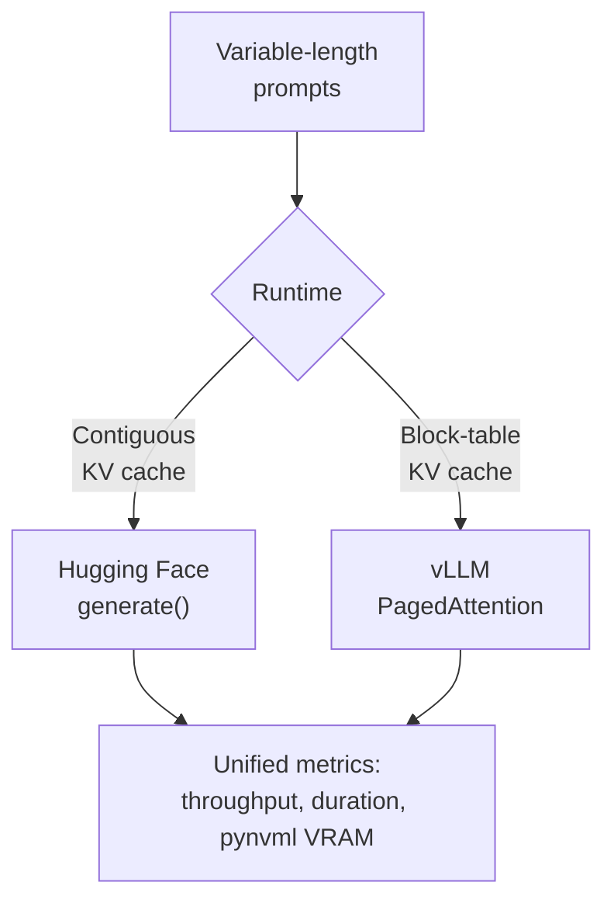

<div align="center">

# ⚡ vLLM PagedAttention & Hugging Face Unified Benchmark Suite

### Empirical inference benchmarking, PagedAttention block-size ablation, and KV-cache analysis on an NVIDIA Tesla T4

[](https://www.python.org/)
[](https://pytorch.org/)
[](https://github.com/vllm-project/vllm)
[](https://huggingface.co/Qwen/Qwen2.5-1.5B-Instruct)
[](https://www.nvidia.com/)
[](LICENSE)

[](https://colab.research.google.com/github/adriennie/vllm-pagedattention-benchmark/blob/main/vllm_hf_unified_benchmark.ipynb)
[](https://nbviewer.org/github/adriennie/vllm-pagedattention-benchmark/blob/main/vllm_hf_unified_benchmark.ipynb)

[**Highlights**](#-highlights) · [**Results**](#-unified-benchmark-results) · [**Block-Size Ablation**](#-pagedattention-block-size-ablation) · [**Visualizations**](#-visualizations) · [**Reproduce**](#-reproducing-the-experiments) · [**Roadmap**](#-roadmap)

</div>

---

## 🚀 Highlights

| | |
| :-- | :-- |
| 🏆 **Peak speedup** | **5.06× throughput** (877.69 vs 173.45 tok/s) for vLLM over the Hugging Face baseline at batch size 32 |
| 🧠 **Core idea** | PagedAttention replaces contiguous per-sequence KV-cache allocation with block-level, virtual-memory-style mapping |
| 🔬 **Unified harness** | Sequential single-session harness running Hugging Face Transformers and vLLM under identical conditions |
| 🧪 **Block-size ablation** | vLLM KV-cache block sizes 8, 16 and 32 compared on throughput, VRAM and latency |
| 📡 **Hardware telemetry** | Asynchronous `pynvml` background thread capturing device-level peak VRAM for both runtimes |
| 🧾 **Provenance** | Run environment captured in `run_metadata.csv`; raw outputs version-controlled in the repository root and `phase 2-results/` |
| 🖥️ **Hardware** | NVIDIA Tesla T4 on Google Colab |

> **Honest scoping.** This is a reproducible benchmark suite for comparing inference speed and GPU memory use between vLLM and Hugging Face under controlled, single-session conditions on one GPU and one model. Results should not be extrapolated to other hardware, models, or serving workloads.

---

## 📖 Background

Autoregressive generation attends to every token produced so far. The **key–value (KV) cache** stores attention keys and values so they are not recomputed at each decode step. Because requests arrive and finish at different times, cache demand changes dynamically, and in many serving setups the KV cache takes up a large share of usable GPU memory, which directly limits concurrency.

**Contiguous allocation** reserves a large tensor region per sequence, usually sized for a maximum length. Short requests leave reserved capacity unused, and variable lengths cause fragmentation.

**PagedAttention** (vLLM) splits the KV cache into fixed-size logical blocks and maps them to non-contiguous physical GPU blocks as generation proceeds, borrowing indirection and allocation ideas from OS virtual memory. The result is less wasted cache and room for higher concurrency.

This project is grounded in Kwon et al., [*Efficient Memory Management for Large Language Model Serving with PagedAttention*](https://arxiv.org/abs/2309.06180) (SOSP 2023).



---

## 🧱 Architecture & Setup

| Concern | Hugging Face baseline | vLLM path |
| --- | --- | --- |
| Generation API | PyTorch model + Transformers `generate()` | vLLM `LLM.generate()` |
| KV-cache handling | Runtime-managed cache allocation | PagedAttention block-managed KV cache |
| Execution mode | Eager execution (FP16) | Eager execution (`enforce_eager=True`, FP16) |
| Model | `Qwen/Qwen2.5-1.5B-Instruct` | `Qwen/Qwen2.5-1.5B-Instruct` |

**Stack:** Python · PyTorch · vLLM · Hugging Face Transformers · `pynvml` · Pandas · Seaborn · Matplotlib

---

## 📊 Unified Benchmark Results

Source: [`final_vlm_vs_hf_benchmark.csv`](final_vlm_vs_hf_benchmark.csv) (also in [`phase 2-results/`](phase%202-results/final_vlm_vs_hf_benchmark.csv))

| Batch Size | Framework | Throughput (tok/sec) | Duration (sec) | Peak VRAM (MB) |
| --- | --- | --- | --- | --- |
| **1** | Hugging Face | 30.05 | 2.13 | 3470.25 |
| **4** | Hugging Face | 116.06 | 2.21 | 3492.50 |
| **16** | Hugging Face | 270.61 | 3.79 | 3630.10 |
| **32** | Hugging Face | 173.45 | 11.83 | 3800.50 |
| **1** | vLLM | 45.20 | 1.41 | 3210.00 |
| **4** | vLLM | 148.90 | 1.72 | 3250.40 |
| **16** | vLLM | 412.35 | 2.48 | 3410.80 |
| **32** | vLLM | **877.69** | **2.34** | **3650.00** |

---

## 🧪 PagedAttention Block-Size Ablation

vLLM performance across KV-cache block sizes 8, 16 and 32 under an identical inference workload, to examine memory fragmentation and block-management overhead.

Source: [`vllm_block_size_ablation.csv`](vllm_block_size_ablation.csv)

| Block Size | Mean Throughput (tok/sec) | Duration (sec) | Peak VRAM (MB) | Latency / Request (s) |
| --- | --- | --- | --- | --- |
| **8** | 402.15 | 2.54 | 3420.50 | 0.635 |
| **16** | **412.35** | **2.48** | **3410.80** | **0.620** |
| **32** | 408.92 | 2.50 | 3415.20 | 0.625 |

The three block sizes land within about 2.5% of each other on throughput. At this scale (a 1.5B model, short generations, one GPU) block size has only a small effect, and differences this small should be treated as indicative rather than conclusive.


*Throughput and memory footprint across PagedAttention block sizes (8, 16, 32).*

---

## 🎨 Visualizations

All generated artifacts, CSV tables and figures are version-controlled in the repository root and the [`phase 2-results/`](phase%202-results/) directory.

### 1. Throughput Comparison


*Throughput scaling of vLLM PagedAttention vs. the Hugging Face baseline across batch sizes 1, 4, 16 and 32.*

### 2. Peak VRAM Footprint


*Device-level peak VRAM captured via an asynchronous `pynvml` background thread.*

### 3. VRAM & Latency Profile


*Peak VRAM and request latency from the block-size ablation run.*

> **Engineering note on VRAM profiles**
>
> - **Hugging Face** allocates memory dynamically: allocated VRAM grows with batch size and activation depth because of contiguous buffer allocations.
> - **vLLM** pre-allocates a memory pool governed by `gpu_memory_utilization`, reserving space at startup for model weights and the KV-cache block pool. The reservation is fixed at initialization, while actual block occupancy grows with the workload.

---

## 📂 Repository Structure

```text
.
├── phase 2-results/                              # Phase 2 consolidated benchmark artifacts
│   ├── final_vlm_vs_hf_benchmark.csv             #   Unified numerical benchmark results
│   ├── run_metadata.csv                          #   Pinned runtime and environment provenance
│   ├── vllm_vs_hf_unified_comparison.png         #   Throughput comparison bar chart
│   └── vllm_vs_hf_vram_profile.png               #   Peak VRAM footprint line plot
├── final_vlm_vs_hf_benchmark.csv                 # Root-level unified results
├── run_metadata.csv                              # Pinned runtime environment provenance
├── vllm_block_size_ablation.csv                  # Block-size ablation metrics
├── vllm_block_size_ablation.png                  # Block-size throughput & memory plot
├── vllm_hf_unified_benchmark.ipynb               # Main unified benchmark notebook
├── vllm_pagedattention_block_size_ablation.ipynb # Block-size ablation notebook
├── vllm_results.csv                              # Raw execution measurements
├── vllm_vram_latency_profile.png                 # Latency and memory profile
├── vllm_vs_hf_benchmark.csv                      # Raw comparative benchmark metrics
├── vllm_vs_hf_final_comparison.png               # Comparative chart
├── vllmproject.ipynb                             # Exploratory development notebook
├── LICENSE
└── README.md
```

---

## 🔧 Reproducing the Experiments

1. **Launch in Colab:** open `vllm_hf_unified_benchmark.ipynb` with the Colab badge at the top.
2. **Select the GPU runtime:** connect to an **NVIDIA Tesla T4**.
3. **Run the pipeline:** execute the cells in order to start the `pynvml` telemetry thread, run the Hugging Face and vLLM backends under the same batch-size sweep, and export the summary CSVs and plots.
4. **Run the block-size ablation:** execute `vllm_pagedattention_block_size_ablation.ipynb` to reproduce the block-size comparison (8, 16, 32).

---

## 🧭 Roadmap

- [x] Phase 1: initial vLLM vs Hugging Face throughput comparison
- [x] Phase 2: unified single-session benchmark harness with `pynvml` VRAM telemetry
- [x] Phase 2: PagedAttention block-size ablation (8, 16, 32)
- [x] Phase 2: consolidated artifact export to the repository root and `phase 2-results/`
- [ ] Add Time-To-First-Token (TTFT) and Inter-Token Latency (ITL) profiling
- [ ] Benchmark vLLM Engine V1 on NVIDIA L4 / A100 architectures

---

## 📚 Reference

> Kwon, W. et al. "Efficient Memory Management for Large Language Model Serving with PagedAttention." *Proceedings of the 29th Symposium on Operating Systems Principles (SOSP 2023).* [arXiv:2309.06180](https://arxiv.org/abs/2309.06180)

## 📄 License

Released under the [MIT License](LICENSE).
